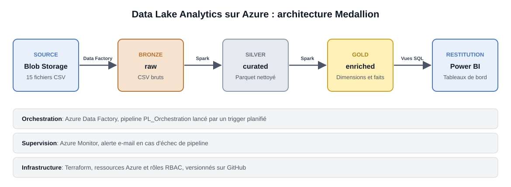

# 🌊 Azure Data Lake Analytics

### Plateforme de données e-commerce de bout en bout, de la donnée brute au tableau de bord

**Architecture Medallion** · **Data Factory** · **Synapse** · **Infrastructure as Code**

---
## Présentation

Ce projet met en place une plateforme d'analyse de données e-commerce de bout en bout sur Microsoft Azure. Il ingère 15 fichiers CSV, les transforme selon l'architecture **Medallion** (Bronze, Silver, Gold) et les expose à Power BI sous la forme d'un modèle dimensionnel. L'infrastructure est déployée avec Terraform, le pipeline est orchestré automatiquement et supervisé par alerte e-mail.

## Objectifs

- Centraliser des données e-commerce dispersées dans un Data Lake structuré en trois couches.
- Garantir la qualité des données : nettoyage, validation, mise en quarantaine des lignes invalides.
- Construire un modèle en constellation (dimensions et faits) prêt pour l'analyse décisionnelle.
- Automatiser la chaîne complète : ingestion, transformation et planification.
- Déployer l'infrastructure de façon reproductible avec Terraform.
- Sécuriser les accès par des rôles RBAC et superviser les exécutions par alerte.

## Architecture

## Auteur

Jihane Bougrine
